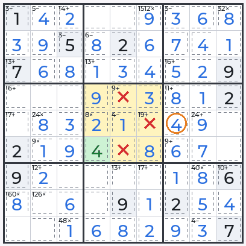

<!-- Written by tools/walkthrough.py calcudoku-killer: edit the script, not this page. -->
# Calcudoku Killer, step 50: the 4 in box 5

**Step 50 of 69** · [← Step 49](step-49.md) · [All steps](../calcudoku-killer.md#the-whole-puzzle-step-by-step) · [Step 51 →](step-51.md)

Box 5 needs a 4. r5c6: row 5 has one (r5c7). r4c5: the 9+ cage (with 3 already in it) needs 6 there. r6c5: in the 4− cage the other digit is 1, and 4 isn't 4 apart from it. Only **r6c4** is left: **r6c4 = 4**.

**Step 50 of 69** · [← Step 49](step-49.md) · [All steps](../calcudoku-killer.md#the-whole-puzzle-step-by-step) · [Step 51 →](step-51.md)
