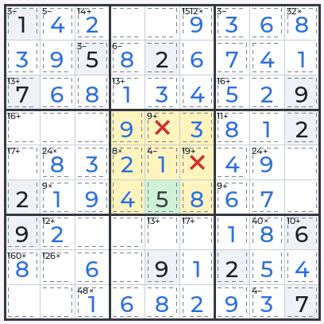

<!-- Written by tools/walkthrough.py calcudoku-killer: edit the script, not this page. -->
# Calcudoku Killer, step 51: the 5 in box 5

**Step 51 of 69** · [← Step 50](step-50.md) · [All steps](../calcudoku-killer.md#the-whole-puzzle-step-by-step) · [Step 52 →](step-52.md)

Box 5 needs a 5. r4c5: the 9+ cage (with 3 already in it) needs 6 there. r5c6: the 19+ cage (with 4 and 8 already in it) needs 7 there. Only **r6c5** is left: **r6c5 = 5**.

**Step 51 of 69** · [← Step 50](step-50.md) · [All steps](../calcudoku-killer.md#the-whole-puzzle-step-by-step) · [Step 52 →](step-52.md)
