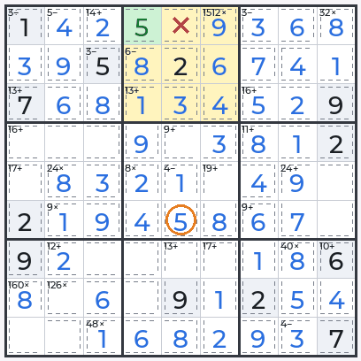

<!-- Written by tools/walkthrough.py calcudoku-killer: edit the script, not this page. -->
# Calcudoku Killer, step 52: the 5 in box 2

**Step 52 of 69** · [← Step 51](step-51.md) · [All steps](../calcudoku-killer.md#the-whole-puzzle-step-by-step) · [Step 53 →](step-53.md)

Box 2 needs a 5. r1c5: column 5 has one (r6c5). Only **r1c4** is left: **r1c4 = 5**.

**Step 52 of 69** · [← Step 51](step-51.md) · [All steps](../calcudoku-killer.md#the-whole-puzzle-step-by-step) · [Step 53 →](step-53.md)
