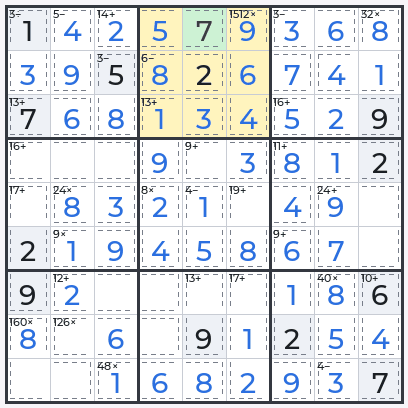

<!-- Written by tools/walkthrough.py calcudoku-killer: edit the script, not this page. -->
# Calcudoku Killer, step 53: the 7 in box 2

**Step 53 of 69** · [← Step 52](step-52.md) · [All steps](../calcudoku-killer.md#the-whole-puzzle-step-by-step) · [Step 54 →](step-54.md)

Box 2 needs a 7, and r1c5 is its last empty cell: **r1c5 = 7**.

**Step 53 of 69** · [← Step 52](step-52.md) · [All steps](../calcudoku-killer.md#the-whole-puzzle-step-by-step) · [Step 54 →](step-54.md)
