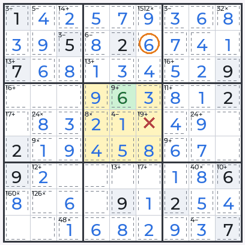

<!-- Written by tools/walkthrough.py calcudoku-killer: edit the script, not this page. -->
# Calcudoku Killer, step 54: the 6 in box 5

**Step 54 of 69** · [← Step 53](step-53.md) · [All steps](../calcudoku-killer.md#the-whole-puzzle-step-by-step) · [Step 55 →](step-55.md)

Box 5 needs a 6. r5c6: column 6 has one (r2c6). Only **r4c5** is left: **r4c5 = 6**.

**Step 54 of 69** · [← Step 53](step-53.md) · [All steps](../calcudoku-killer.md#the-whole-puzzle-step-by-step) · [Step 55 →](step-55.md)
