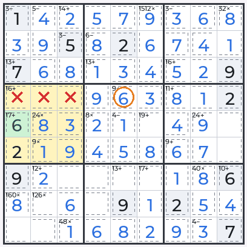

<!-- Written by tools/walkthrough.py calcudoku-killer: edit the script, not this page. -->
# Calcudoku Killer, step 55: the 6 in box 4

**Step 55 of 69** · [← Step 54](step-54.md) · [All steps](../calcudoku-killer.md#the-whole-puzzle-step-by-step) · [Step 56 →](step-56.md)

Box 4 needs a 6. r4c1, r4c2 and r4c3: row 4 has one (r4c5). Only **r5c1** is left: **r5c1 = 6**.

**Step 55 of 69** · [← Step 54](step-54.md) · [All steps](../calcudoku-killer.md#the-whole-puzzle-step-by-step) · [Step 56 →](step-56.md)
