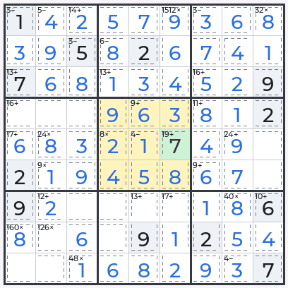

<!-- Written by tools/walkthrough.py calcudoku-killer: edit the script, not this page. -->
# Calcudoku Killer, step 56: the 7 in box 5

**Step 56 of 69** · [← Step 55](step-55.md) · [All steps](../calcudoku-killer.md#the-whole-puzzle-step-by-step) · [Step 57 →](step-57.md)

Box 5 needs a 7, and r5c6 is its last empty cell: **r5c6 = 7**.

**Step 56 of 69** · [← Step 55](step-55.md) · [All steps](../calcudoku-killer.md#the-whole-puzzle-step-by-step) · [Step 57 →](step-57.md)
