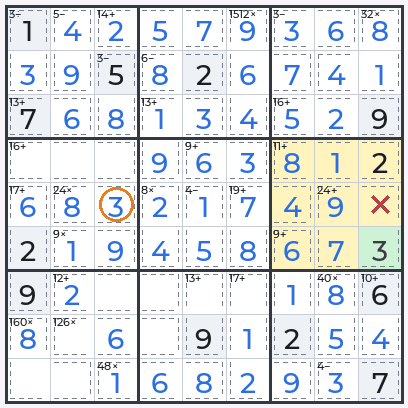

<!-- Written by tools/walkthrough.py calcudoku-killer: edit the script, not this page. -->
# Calcudoku Killer, step 57: the 3 in box 6

**Step 57 of 69** · [← Step 56](step-56.md) · [All steps](../calcudoku-killer.md#the-whole-puzzle-step-by-step) · [Step 58 →](step-58.md)

Box 6 needs a 3. r5c9: row 5 has one (r5c3). Only **r6c9** is left: **r6c9 = 3**.

**Step 57 of 69** · [← Step 56](step-56.md) · [All steps](../calcudoku-killer.md#the-whole-puzzle-step-by-step) · [Step 58 →](step-58.md)
