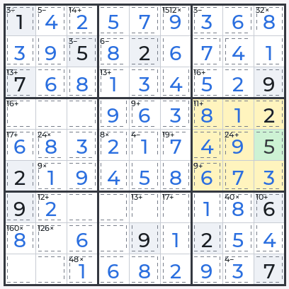

<!-- Written by tools/walkthrough.py calcudoku-killer: edit the script, not this page. -->
# Calcudoku Killer, step 58: the 5 in box 6

**Step 58 of 69** · [← Step 57](step-57.md) · [All steps](../calcudoku-killer.md#the-whole-puzzle-step-by-step) · [Step 59 →](step-59.md)

Box 6 needs a 5, and r5c9 is its last empty cell: **r5c9 = 5**.

**Step 58 of 69** · [← Step 57](step-57.md) · [All steps](../calcudoku-killer.md#the-whole-puzzle-step-by-step) · [Step 59 →](step-59.md)
