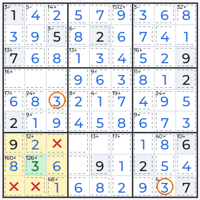

<!-- Written by tools/walkthrough.py calcudoku-killer: edit the script, not this page. -->
# Calcudoku Killer, step 59: the 3 in box 7

**Step 59 of 69** · [← Step 58](step-58.md) · [All steps](../calcudoku-killer.md#the-whole-puzzle-step-by-step) · [Step 60 →](step-60.md)

Box 7 needs a 3. r7c3: column 3 has one (r5c3). r9c1 and r9c2: row 9 has one (r9c8). Only **r8c2** is left: **r8c2 = 3**.

**Step 59 of 69** · [← Step 58](step-58.md) · [All steps](../calcudoku-killer.md#the-whole-puzzle-step-by-step) · [Step 60 →](step-60.md)
