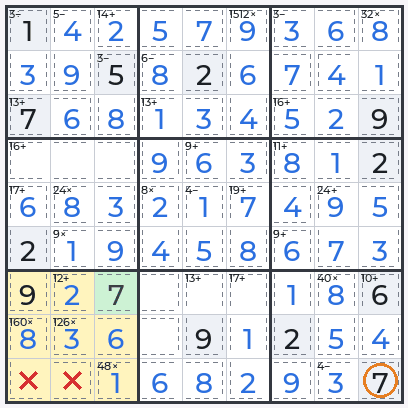

<!-- Written by tools/walkthrough.py calcudoku-killer: edit the script, not this page. -->
# Calcudoku Killer, step 60: the 7 in box 7

**Step 60 of 69** · [← Step 59](step-59.md) · [All steps](../calcudoku-killer.md#the-whole-puzzle-step-by-step) · [Step 61 →](step-61.md)

Box 7 needs a 7. r9c1 and r9c2: row 9 has one (r9c9). Only **r7c3** is left: **r7c3 = 7**.

**Step 60 of 69** · [← Step 59](step-59.md) · [All steps](../calcudoku-killer.md#the-whole-puzzle-step-by-step) · [Step 61 →](step-61.md)
