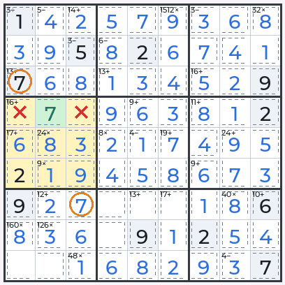

<!-- Written by tools/walkthrough.py calcudoku-killer: edit the script, not this page. -->
# Calcudoku Killer, step 61: the 7 in box 4

**Step 61 of 69** · [← Step 60](step-60.md) · [All steps](../calcudoku-killer.md#the-whole-puzzle-step-by-step) · [Step 62 →](step-62.md)

Box 4 needs a 7. r4c1: column 1 has one (r3c1). r4c3: column 3 has one (r7c3). Only **r4c2** is left: **r4c2 = 7**.

**Step 61 of 69** · [← Step 60](step-60.md) · [All steps](../calcudoku-killer.md#the-whole-puzzle-step-by-step) · [Step 62 →](step-62.md)
