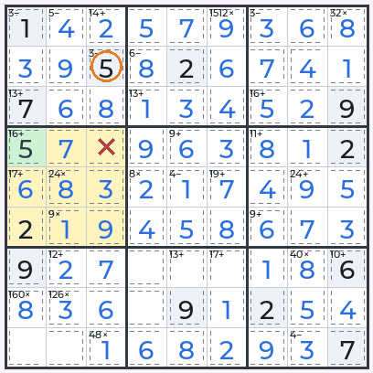

<!-- Written by tools/walkthrough.py calcudoku-killer: edit the script, not this page. -->
# Calcudoku Killer, step 62: the 5 in box 4

**Step 62 of 69** · [← Step 61](step-61.md) · [All steps](../calcudoku-killer.md#the-whole-puzzle-step-by-step) · [Step 63 →](step-63.md)

Box 4 needs a 5. r4c3: column 3 has one (r2c3). Only **r4c1** is left: **r4c1 = 5**.

**Step 62 of 69** · [← Step 61](step-61.md) · [All steps](../calcudoku-killer.md#the-whole-puzzle-step-by-step) · [Step 63 →](step-63.md)
