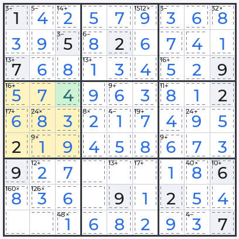

<!-- Written by tools/walkthrough.py calcudoku-killer: edit the script, not this page. -->
# Calcudoku Killer, step 63: the 4 in box 4

**Step 63 of 69** · [← Step 62](step-62.md) · [All steps](../calcudoku-killer.md#the-whole-puzzle-step-by-step) · [Step 64 →](step-64.md)

Box 4 needs a 4, and r4c3 is its last empty cell: **r4c3 = 4**.

**Step 63 of 69** · [← Step 62](step-62.md) · [All steps](../calcudoku-killer.md#the-whole-puzzle-step-by-step) · [Step 64 →](step-64.md)
