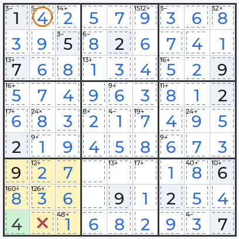

<!-- Written by tools/walkthrough.py calcudoku-killer: edit the script, not this page. -->
# Calcudoku Killer, step 64: the 4 in box 7

**Step 64 of 69** · [← Step 63](step-63.md) · [All steps](../calcudoku-killer.md#the-whole-puzzle-step-by-step) · [Step 65 →](step-65.md)

Box 7 needs a 4. r9c2: column 2 has one (r1c2). Only **r9c1** is left: **r9c1 = 4**.

**Step 64 of 69** · [← Step 63](step-63.md) · [All steps](../calcudoku-killer.md#the-whole-puzzle-step-by-step) · [Step 65 →](step-65.md)
