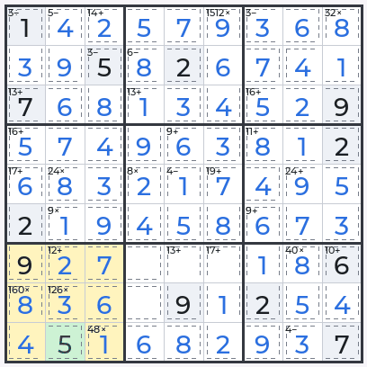

<!-- Written by tools/walkthrough.py calcudoku-killer: edit the script, not this page. -->
# Calcudoku Killer, step 65: the 5 in box 7

**Step 65 of 69** · [← Step 64](step-64.md) · [All steps](../calcudoku-killer.md#the-whole-puzzle-step-by-step) · [Step 66 →](step-66.md)

Box 7 needs a 5, and r9c2 is its last empty cell: **r9c2 = 5**.

**Step 65 of 69** · [← Step 64](step-64.md) · [All steps](../calcudoku-killer.md#the-whole-puzzle-step-by-step) · [Step 66 →](step-66.md)
