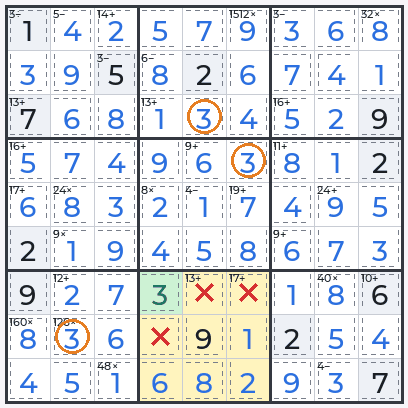

<!-- Written by tools/walkthrough.py calcudoku-killer: edit the script, not this page. -->
# Calcudoku Killer, step 66: the 3 in box 8

**Step 66 of 69** · [← Step 65](step-65.md) · [All steps](../calcudoku-killer.md#the-whole-puzzle-step-by-step) · [Step 67 →](step-67.md)

Box 8 needs a 3. r7c5: column 5 has one (r3c5). r7c6: column 6 has one (r4c6). r8c4: row 8 has one (r8c2). Only **r7c4** is left: **r7c4 = 3**.

**Step 66 of 69** · [← Step 65](step-65.md) · [All steps](../calcudoku-killer.md#the-whole-puzzle-step-by-step) · [Step 67 →](step-67.md)
