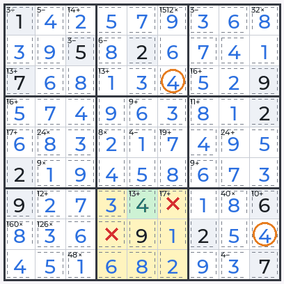

<!-- Written by tools/walkthrough.py calcudoku-killer: edit the script, not this page. -->
# Calcudoku Killer, step 67: the 4 in box 8

**Step 67 of 69** · [← Step 66](step-66.md) · [All steps](../calcudoku-killer.md#the-whole-puzzle-step-by-step) · [Step 68 →](step-68.md)

Box 8 needs a 4. r7c6: column 6 has one (r3c6). r8c4: row 8 has one (r8c9). Only **r7c5** is left: **r7c5 = 4**.

**Step 67 of 69** · [← Step 66](step-66.md) · [All steps](../calcudoku-killer.md#the-whole-puzzle-step-by-step) · [Step 68 →](step-68.md)
