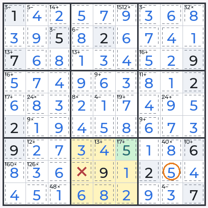

<!-- Written by tools/walkthrough.py calcudoku-killer: edit the script, not this page. -->
# Calcudoku Killer, step 68: the 5 in box 8

**Step 68 of 69** · [← Step 67](step-67.md) · [All steps](../calcudoku-killer.md#the-whole-puzzle-step-by-step) · [Step 69 →](step-69.md)

Box 8 needs a 5. r8c4: row 8 has one (r8c8). Only **r7c6** is left: **r7c6 = 5**.

**Step 68 of 69** · [← Step 67](step-67.md) · [All steps](../calcudoku-killer.md#the-whole-puzzle-step-by-step) · [Step 69 →](step-69.md)
