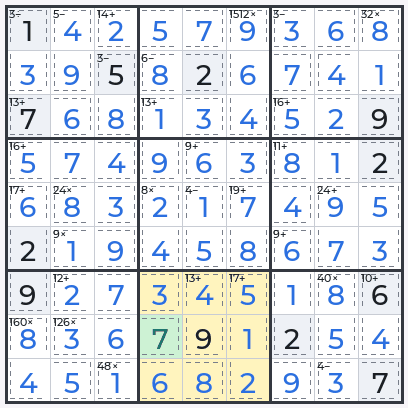

<!-- Written by tools/walkthrough.py calcudoku-killer: edit the script, not this page. -->
# Calcudoku Killer, step 69: the 7 in box 8

**Step 69 of 69** · [← Step 68](step-68.md) · [All steps](../calcudoku-killer.md#the-whole-puzzle-step-by-step) · [All steps](../calcudoku-killer.md#the-whole-puzzle-step-by-step)

Box 8 needs a 7, and r8c4 is its last empty cell: **r8c4 = 7**.

Solved.

**Step 69 of 69** · [← Step 68](step-68.md) · [All steps](../calcudoku-killer.md#the-whole-puzzle-step-by-step) · [All steps](../calcudoku-killer.md#the-whole-puzzle-step-by-step)
