# Center Dot

[← All variants](README.md) · [Puzzles](../features-puzzles.md) · [How to play](../how-to-play.md)

## The rules

[Classic](classic.md) rules, and the **nine centre cells of the boxes** (tinted) also hold 1 to 9, each once. They make a tenth "box" spread over the whole grid: rows 2, 5 and 8 crossed with columns 2, 5 and 8.

## On the board

- The nine centres are tinted, like Asterisk's cells.
- Two equal digits in the centres turn red, like any repeat in a row, column or box.
- Hints name the group: "Look at the box centres: ..."; the grader treats it as one more unit.
- **Puzzles → ⋮ → New puzzle → Grids → Center Dot**.

## How to solve it

- **One more place to look for a hidden single:** each digit goes in exactly one box centre, so the centres can be scanned like a box.
- **A centre sees four more cells:** besides its own row, column and box, each centre rules its digit out of the four centres it shares no row or column with.
- **A digit placed in a centre clears the other centres** of that digit, which often leaves a box's centre the only spot left for a digit in that box, or the reverse.

## Worked example

**variant-examples #34**, Center Dot Easy (see [Classic](classic.md#worked-example-the-whole-puzzle) for how to import the examples; cells are written r*row*c*column*).

**Step 1: the 5 in column 2.** Column 2 has 1, 2 and 6; r1c2, r6c2, r8c2 and r9c2 see the 5s of their rows (r1c7, r6c4, r8c8, r9c5). That leaves r5c2 and r7c2. r5c2 is a box centre (box 4's), and the centre of box 9, r8c8, is a 5 already. **r7c2 = 5**.

**Step 2: the 5 in box 1.** r1c1, r1c2 and r1c3 see the 5 in r1c7; the box's other cells are filled except r2c3. **r2c3 = 5**.

**Step 3: the 5 in box 2.** Row 1 has a 5 (r1c7), row 2 one (r2c3), and columns 4 and 5 have theirs (r6c4, r9c5). The one cell left is **r3c6 = 5**.

## The whole puzzle, step by step

<!-- walkthrough -->
<!-- Written by tools/walkthrough.py center-dot: edit the script, not this part. -->

The whole puzzle, from the start to the last cell: 46 steps, each one a single (one place left for a digit, or one digit left for a cell), taken in the order a box's single comes first, so not quite the order of the worked example above. In each picture, the unit the step looks at is tinted yellow (for a cell with one digit left: its row, column and box), the new digit is on green, the digits that rule cells out have an **orange ring**, and the empty cells they rule out a **red cross**. Givens are on grey, digits from earlier steps in blue.

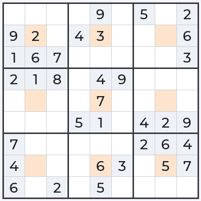

#### Step 1: the 5 in box 1

Box 1 needs a 5. r1c1, r1c2 and r1c3: row 1 has one (r1c7). Only **r2c3** is left: **r2c3 = 5**.

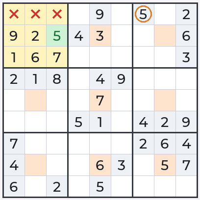

#### Step 2: the 5 in box 2

Box 2 needs a 5. r1c4 and r1c6: row 1 has one (r1c7). r2c6: row 2 has one (r2c3). r3c4: column 4 has one (r6c4). r3c5: column 5 has one (r9c5). Only **r3c6** is left: **r3c6 = 5**.

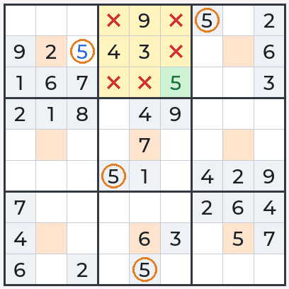

#### Step 3: the 5 in box 4

Box 4 needs a 5. r5c2: the box centres have one (r8c8). r5c3: column 3 has one (r2c3). r6c1, r6c2 and r6c3: row 6 has one (r6c4). Only **r5c1** is left: **r5c1 = 5**.

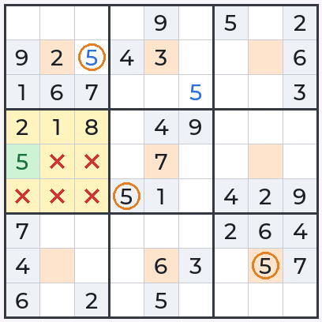

#### Step 4: the 7 in box 4

Box 4 needs a 7. r5c2 and r5c3: row 5 has one (r5c5). r6c1: column 1 has one (r7c1). r6c3: column 3 has one (r3c3). Only **r6c2** is left: **r6c2 = 7**.

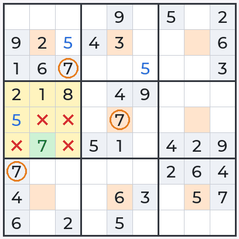

#### Step 5: the 5 in box 6

Box 6 needs a 5. r4c7: column 7 has one (r1c7). r4c8: column 8 has one (r8c8). r5c7, r5c8 and r5c9: row 5 has one (r5c1). Only **r4c9** is left: **r4c9 = 5**.

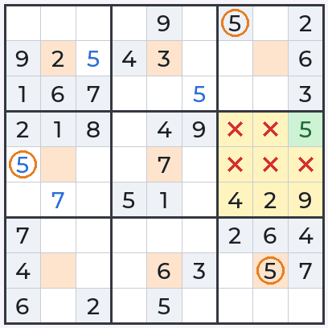

#### Step 6: the 5 in box 7

Box 7 needs a 5. r7c3: column 3 has one (r2c3). r8c2 and r8c3: row 8 has one (r8c8). r9c2: row 9 has one (r9c5). Only **r7c2** is left: **r7c2 = 5**.

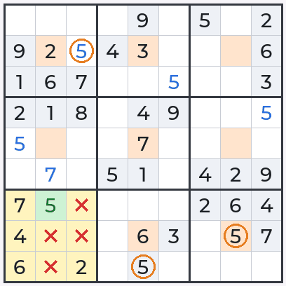

#### Step 7: the 2 in box 8

Box 8 needs a 2. r7c4, r7c5 and r7c6: row 7 has one (r7c7). r9c4 and r9c6: row 9 has one (r9c3). Only **r8c4** is left: **r8c4 = 2**.

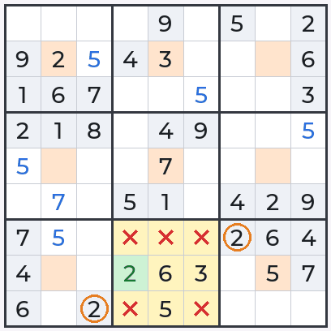

#### Step 8: the 2 in box 2

Box 2 needs a 2. r1c4 and r1c6: row 1 has one (r1c9). r2c6: row 2 has one (r2c2). r3c4: column 4 has one (r8c4). Only **r3c5** is left: **r3c5 = 2**.

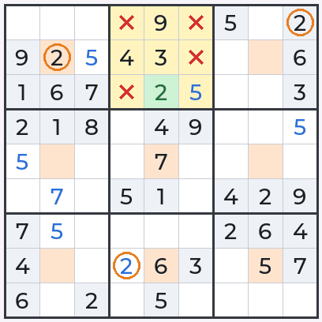

#### Step 9: the 2 in box 5

Box 5 needs a 2. r4c4: row 4 has one (r4c1). r5c4: column 4 has one (r8c4). r6c6: row 6 has one (r6c8). Only **r5c6** is left: **r5c6 = 2**.

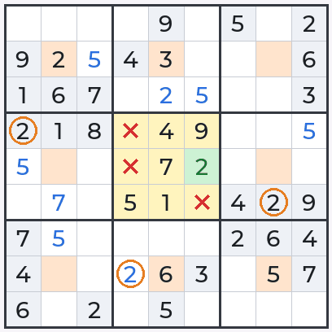

#### Step 10: the 4 in box 8

Box 8 needs a 4. r7c4, r7c5 and r7c6: row 7 has one (r7c9). r9c4: column 4 has one (r2c4). Only **r9c6** is left: **r9c6 = 4**.

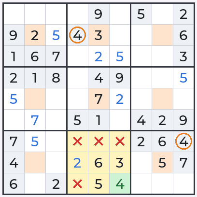

#### Step 11: the 7 in box 8

Box 8 needs a 7. r7c4, r7c5 and r7c6: row 7 has one (r7c1). Only **r9c4** is left: **r9c4 = 7**.

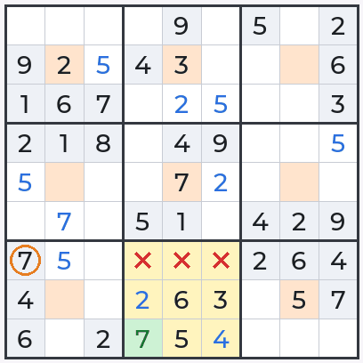

#### Step 12: the 9 in box 8

Box 8 needs a 9. r7c5: column 5 has one (r1c5). r7c6: column 6 has one (r4c6). Only **r7c4** is left: **r7c4 = 9**.

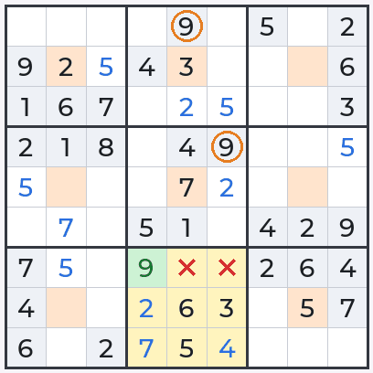

#### Step 13: the 1 in box 8

Box 8 needs a 1. r7c5: column 5 has one (r6c5). Only **r7c6** is left: **r7c6 = 1**.

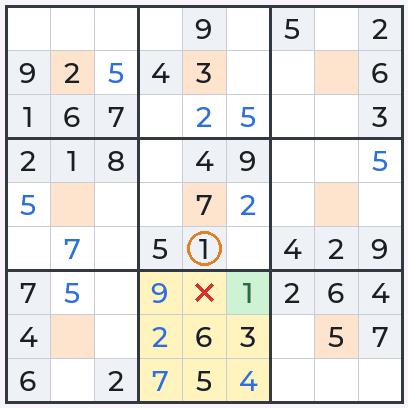

#### Step 14: the 1 in box 2

Box 2 needs a 1. r1c6 and r2c6: column 6 has one (r7c6). r3c4: row 3 has one (r3c1). Only **r1c4** is left: **r1c4 = 1**.

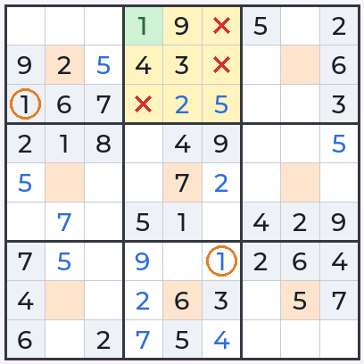

#### Step 15: the 6 in box 2

Box 2 needs a 6. r2c6: row 2 has one (r2c9). r3c4: row 3 has one (r3c2). Only **r1c6** is left: **r1c6 = 6**.

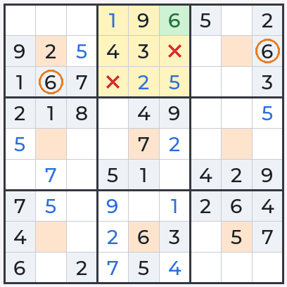

#### Step 16: the 7 in box 2

Box 2 needs a 7. r3c4: row 3 has one (r3c3). Only **r2c6** is left: **r2c6 = 7**.

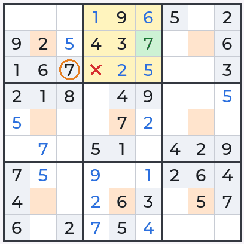

#### Step 17: the 8 in box 2

Box 2 needs an 8, and r3c4 is its last empty cell: **r3c4 = 8**.

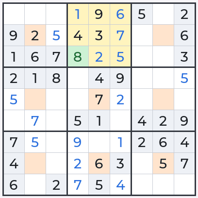

#### Step 18: the 7 in box 3

Box 3 needs a 7. r2c7 and r2c8: row 2 has one (r2c6). r3c7 and r3c8: row 3 has one (r3c3). Only **r1c8** is left: **r1c8 = 7**.

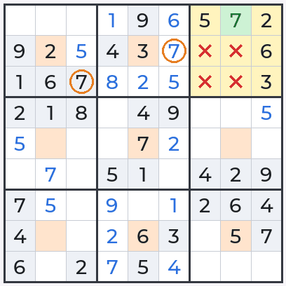

#### Step 19: the 4 in box 3

Box 3 needs a 4. r2c7 and r2c8: row 2 has one (r2c4). r3c7: column 7 has one (r6c7). Only **r3c8** is left: **r3c8 = 4**.

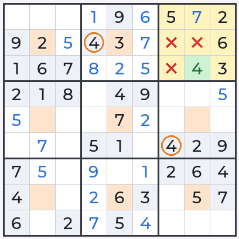

#### Step 20: the 9 in box 3

Box 3 needs a 9. r2c7 and r2c8: row 2 has one (r2c1). Only **r3c7** is left: **r3c7 = 9**.

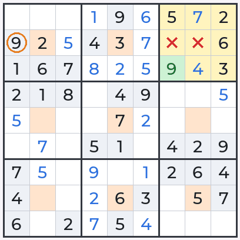

#### Step 21: the 8 in box 5

Box 5 needs an 8. r4c4: row 4 has one (r4c3). r5c4: column 4 has one (r3c4). Only **r6c6** is left: **r6c6 = 8**.

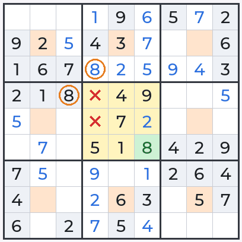

#### Step 22: the 7 in box 6

Box 6 needs a 7. r4c8: column 8 has one (r1c8). r5c7, r5c8 and r5c9: row 5 has one (r5c5). Only **r4c7** is left: **r4c7 = 7**.

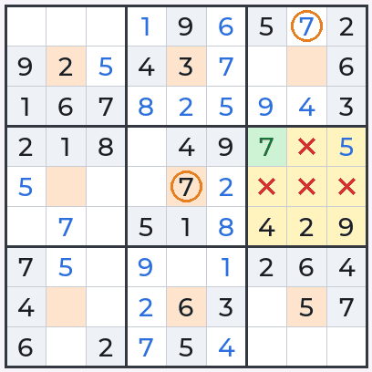

#### Step 23: the 6 in box 6

Box 6 needs a 6. r4c8 and r5c8: column 8 has one (r7c8). r5c9: column 9 has one (r2c9). Only **r5c7** is left: **r5c7 = 6**.

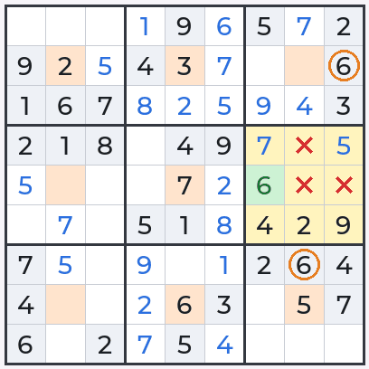

#### Step 24: the 6 in box 4

Box 4 needs a 6. r5c2 and r5c3: row 5 has one (r5c7). r6c1: column 1 has one (r9c1). Only **r6c3** is left: **r6c3 = 6**.

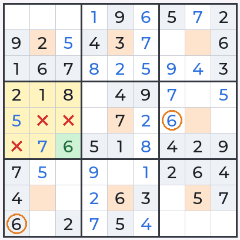

#### Step 25: the 6 in box 5

Box 5 needs a 6. r5c4: row 5 has one (r5c7). Only **r4c4** is left: **r4c4 = 6**.

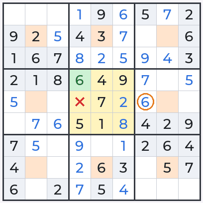

#### Step 26: the 3 in box 5

Box 5 needs a 3, and r5c4 is its last empty cell: **r5c4 = 3**.

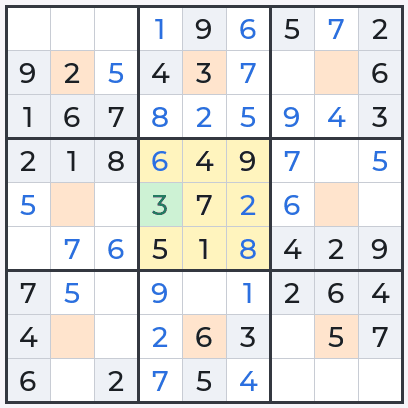

#### Step 27: the 3 in box 4

Box 4 needs a 3. r5c2 and r5c3: row 5 has one (r5c4). Only **r6c1** is left: **r6c1 = 3**.

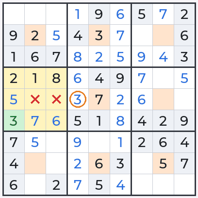

#### Step 28: the 3 in box 6

Box 6 needs a 3. r5c8 and r5c9: row 5 has one (r5c4). Only **r4c8** is left: **r4c8 = 3**.

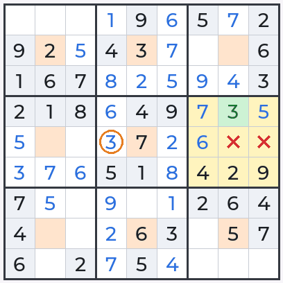

#### Step 29: the 1 in box 7

Box 7 needs a 1. r7c3: row 7 has one (r7c6). r8c2 and r9c2: column 2 has one (r4c2). Only **r8c3** is left: **r8c3 = 1**.

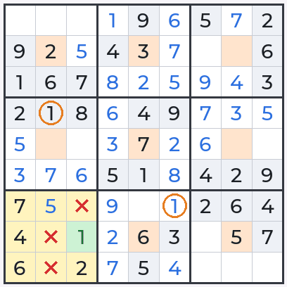

#### Step 30: the 8 in box 8

Box 8 needs an 8, and r7c5 is its last empty cell: **r7c5 = 8**.

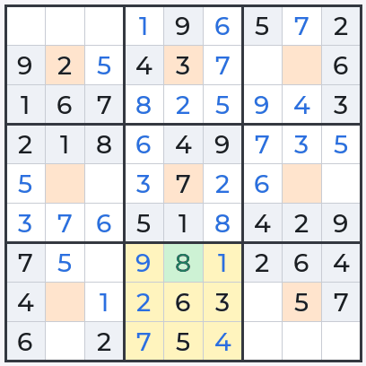

#### Step 31: the 3 in box 9

Box 9 needs a 3. r8c7: row 8 has one (r8c6). r9c8: column 8 has one (r4c8). r9c9: column 9 has one (r3c9). Only **r9c7** is left: **r9c7 = 3**.

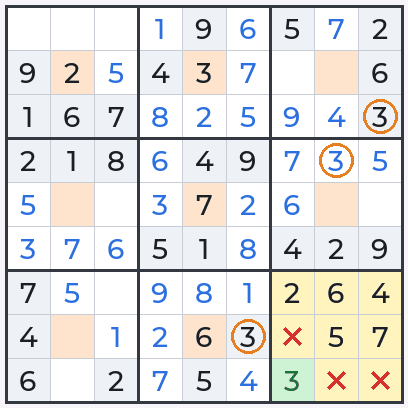

#### Step 32: the 3 in box 7

Box 7 needs a 3. r8c2: row 8 has one (r8c6). r9c2: row 9 has one (r9c7). Only **r7c3** is left: **r7c3 = 3**.

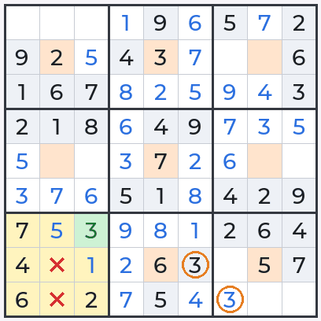

#### Step 33: the 3 in box 1

Box 1 needs a 3. r1c1: column 1 has one (r6c1). r1c3: column 3 has one (r7c3). Only **r1c2** is left: **r1c2 = 3**.

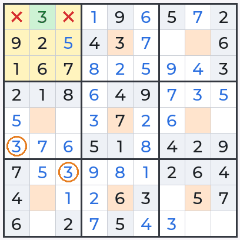

#### Step 34: the 4 in box 1

Box 1 needs a 4. r1c1: column 1 has one (r8c1). Only **r1c3** is left: **r1c3 = 4**.

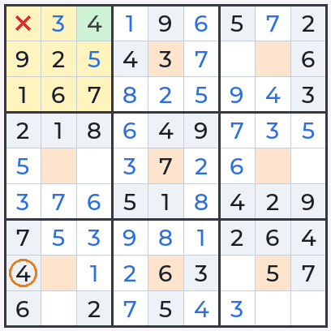

#### Step 35: the 8 in box 1

Box 1 needs an 8, and r1c1 is its last empty cell: **r1c1 = 8**.

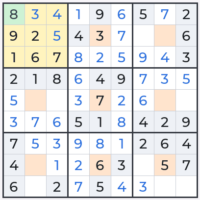

#### Step 36: the 4 in box 4

Box 4 needs a 4. r5c3: column 3 has one (r1c3). Only **r5c2** is left: **r5c2 = 4**.

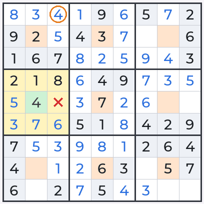

#### Step 37: the 9 in box 4

Box 4 needs a 9, and r5c3 is its last empty cell: **r5c3 = 9**.

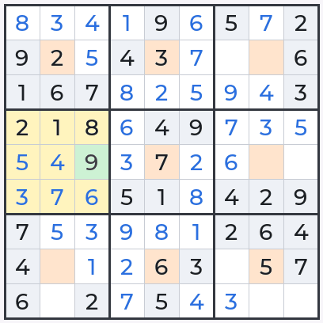

#### Step 38: the 9 in box 9

Box 9 needs a 9. r8c7: column 7 has one (r3c7). r9c9: column 9 has one (r6c9). Only **r9c8** is left: **r9c8 = 9**.

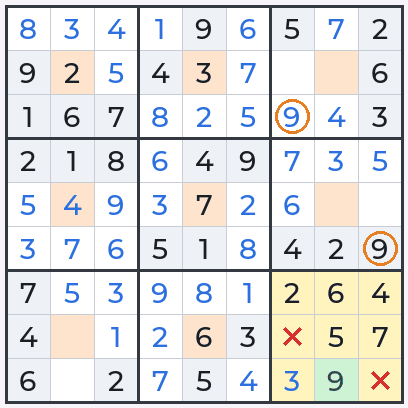

#### Step 39: the 9 in box 7

Box 7 needs a 9. r9c2: row 9 has one (r9c8). Only **r8c2** is left: **r8c2 = 9**.

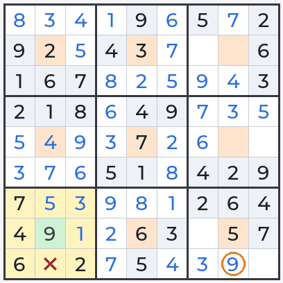

#### Step 40: the 8 in box 7

Box 7 needs an 8, and r9c2 is its last empty cell: **r9c2 = 8**.

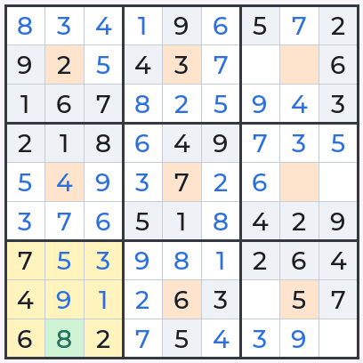

#### Step 41: the 1 in box 9

Box 9 needs a 1. r8c7: row 8 has one (r8c3). Only **r9c9** is left: **r9c9 = 1**.

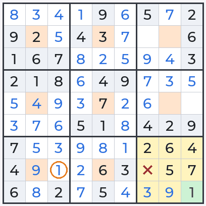

#### Step 42: the 1 in box 6

Box 6 needs a 1. r5c9: column 9 has one (r9c9). Only **r5c8** is left: **r5c8 = 1**.

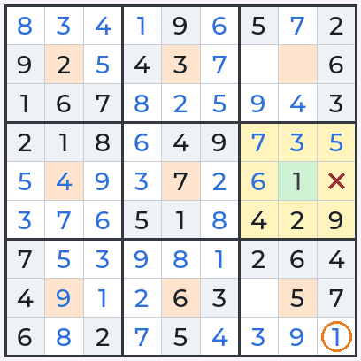

#### Step 43: the 1 in box 3

Box 3 needs a 1. r2c8: column 8 has one (r5c8). Only **r2c7** is left: **r2c7 = 1**.

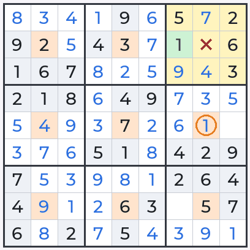

#### Step 44: the 8 in box 3

Box 3 needs an 8, and r2c8 is its last empty cell: **r2c8 = 8**.

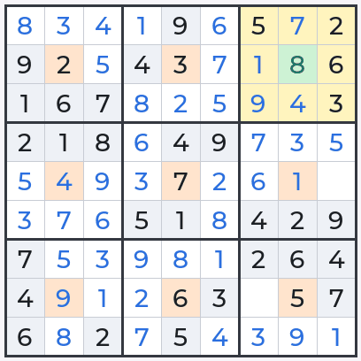

#### Step 45: the 8 in box 6

Box 6 needs an 8, and r5c9 is its last empty cell: **r5c9 = 8**.

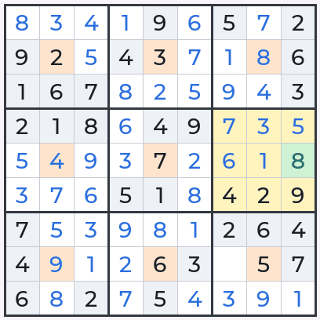

#### Step 46: the 8 in box 9

Box 9 needs an 8, and r8c7 is its last empty cell: **r8c7 = 8**.

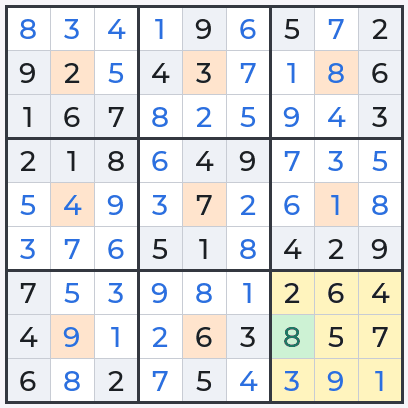

Solved.

<!-- /walkthrough -->
