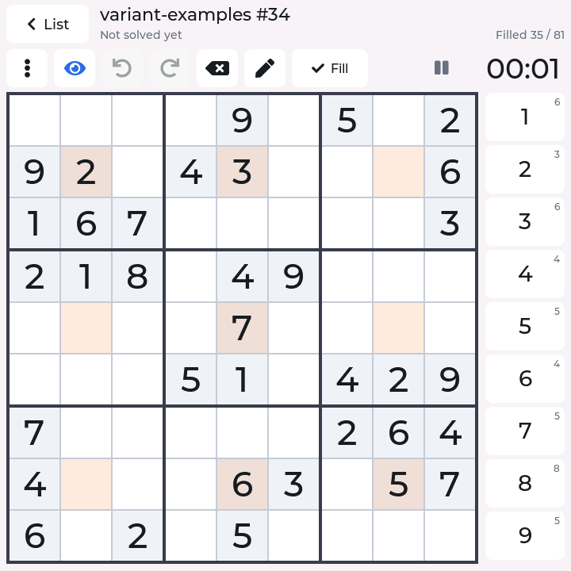

# Center Dot

[← All variants](README.md) · [Puzzles](../features-puzzles.md) · [How to play](../how-to-play.md)

## The rules

[Classic](classic.md) rules, and the **nine centre cells of the boxes** (tinted) also hold 1 to 9, each once. They make a tenth "box" spread over the whole grid: rows 2, 5 and 8 crossed with columns 2, 5 and 8.

## On the board

- The nine centres are tinted, like Asterisk's cells.
- Two equal digits in the centres turn red, like any repeat in a row, column or box.
- Hints name the group: "Look at the box centres: ..."; the grader treats it as one more unit.
- **Puzzles → ⋮ → New puzzle → Grids → Center Dot**.

## How to solve it

- **One more place to look for a hidden single:** each digit goes in exactly one box centre, so the centres can be scanned like a box.
- **A centre sees four more cells:** besides its own row, column and box, each centre rules its digit out of the four centres it shares no row or column with.
- **A digit placed in a centre clears the other centres** of that digit, which often leaves a box's centre the only spot left for a digit in that box, or the reverse.

## Worked example

**variant-examples #34**, Center Dot Easy (see [Classic](classic.md#worked-example-the-whole-puzzle) for how to import the examples; cells are written r*row*c*column*).

**Step 1: the 5 in column 2.** Column 2 has 1, 2 and 6; r1c2, r6c2, r8c2 and r9c2 see the 5s of their rows (r1c7, r6c4, r8c8, r9c5). That leaves r5c2 and r7c2. r5c2 is a box centre (box 4's), and the centre of box 9, r8c8, is a 5 already. **r7c2 = 5**.

**Step 2: the 5 in box 1.** r1c1, r1c2 and r1c3 see the 5 in r1c7; the box's other cells are filled except r2c3. **r2c3 = 5**.

**Step 3: the 5 in box 2.** Row 1 has a 5 (r1c7), row 2 one (r2c3), and columns 4 and 5 have theirs (r6c4, r9c5). The one cell left is **r3c6 = 5**.

## The whole puzzle, step by step

<!-- walkthrough -->
<!-- Written by tools/walkthrough.py center-dot: edit the script, not this part. -->

The whole puzzle, from the start to the last cell: 46 steps, each one a single (one place left for a digit, or one digit left for a cell), taken in the order a box's single comes first, so not quite the order of the worked example above. Each step has a page of its own, with **Previous** and **Next**: pick its number below. In each picture, the unit the step looks at is tinted yellow (for a cell with one digit left: its row, column and box), the new digit is on green, the digits that rule cells out have an **orange ring**, and the empty cells they rule out a **red cross**. Givens are on grey, digits from earlier steps in blue.

| [1](center-dot/step-01.md) | [2](center-dot/step-02.md) | [3](center-dot/step-03.md) | [4](center-dot/step-04.md) | [5](center-dot/step-05.md) | [6](center-dot/step-06.md) | [7](center-dot/step-07.md) | [8](center-dot/step-08.md) | [9](center-dot/step-09.md) | [10](center-dot/step-10.md) |
|:-:|:-:|:-:|:-:|:-:|:-:|:-:|:-:|:-:|:-:|
| [11](center-dot/step-11.md) | [12](center-dot/step-12.md) | [13](center-dot/step-13.md) | [14](center-dot/step-14.md) | [15](center-dot/step-15.md) | [16](center-dot/step-16.md) | [17](center-dot/step-17.md) | [18](center-dot/step-18.md) | [19](center-dot/step-19.md) | [20](center-dot/step-20.md) |
| [21](center-dot/step-21.md) | [22](center-dot/step-22.md) | [23](center-dot/step-23.md) | [24](center-dot/step-24.md) | [25](center-dot/step-25.md) | [26](center-dot/step-26.md) | [27](center-dot/step-27.md) | [28](center-dot/step-28.md) | [29](center-dot/step-29.md) | [30](center-dot/step-30.md) |
| [31](center-dot/step-31.md) | [32](center-dot/step-32.md) | [33](center-dot/step-33.md) | [34](center-dot/step-34.md) | [35](center-dot/step-35.md) | [36](center-dot/step-36.md) | [37](center-dot/step-37.md) | [38](center-dot/step-38.md) | [39](center-dot/step-39.md) | [40](center-dot/step-40.md) |
| [41](center-dot/step-41.md) | [42](center-dot/step-42.md) | [43](center-dot/step-43.md) | [44](center-dot/step-44.md) | [45](center-dot/step-45.md) | [46](center-dot/step-46.md) |  |  |  |  |

Solved.

<!-- /walkthrough -->
