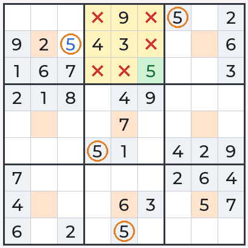

<!-- Written by tools/walkthrough.py center-dot: edit the script, not this page. -->
# Center Dot, step 2: the 5 in box 2

**Step 2 of 46** · [← Step 1](step-01.md) · [All steps](../center-dot.md#the-whole-puzzle-step-by-step) · [Step 3 →](step-03.md)

Box 2 needs a 5. r1c4 and r1c6: row 1 has one (r1c7). r2c6: row 2 has one (r2c3). r3c4: column 4 has one (r6c4). r3c5: column 5 has one (r9c5). Only **r3c6** is left: **r3c6 = 5**.

**Step 2 of 46** · [← Step 1](step-01.md) · [All steps](../center-dot.md#the-whole-puzzle-step-by-step) · [Step 3 →](step-03.md)
