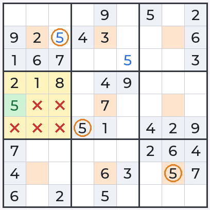

<!-- Written by tools/walkthrough.py center-dot: edit the script, not this page. -->
# Center Dot, step 3: the 5 in box 4

**Step 3 of 46** · [← Step 2](step-02.md) · [All steps](../center-dot.md#the-whole-puzzle-step-by-step) · [Step 4 →](step-04.md)

Box 4 needs a 5. r5c2: the box centres have one (r8c8). r5c3: column 3 has one (r2c3). r6c1, r6c2 and r6c3: row 6 has one (r6c4). Only **r5c1** is left: **r5c1 = 5**.

**Step 3 of 46** · [← Step 2](step-02.md) · [All steps](../center-dot.md#the-whole-puzzle-step-by-step) · [Step 4 →](step-04.md)
