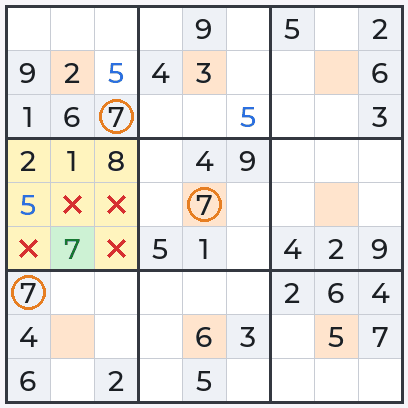

<!-- Written by tools/walkthrough.py center-dot: edit the script, not this page. -->
# Center Dot, step 4: the 7 in box 4

**Step 4 of 46** · [← Step 3](step-03.md) · [All steps](../center-dot.md#the-whole-puzzle-step-by-step) · [Step 5 →](step-05.md)

Box 4 needs a 7. r5c2 and r5c3: row 5 has one (r5c5). r6c1: column 1 has one (r7c1). r6c3: column 3 has one (r3c3). Only **r6c2** is left: **r6c2 = 7**.

**Step 4 of 46** · [← Step 3](step-03.md) · [All steps](../center-dot.md#the-whole-puzzle-step-by-step) · [Step 5 →](step-05.md)
