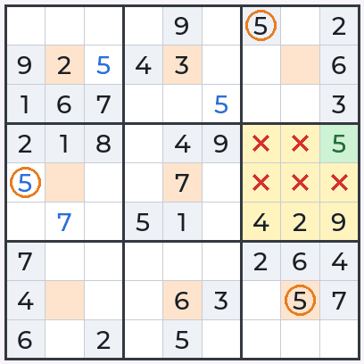

<!-- Written by tools/walkthrough.py center-dot: edit the script, not this page. -->
# Center Dot, step 5: the 5 in box 6

**Step 5 of 46** · [← Step 4](step-04.md) · [All steps](../center-dot.md#the-whole-puzzle-step-by-step) · [Step 6 →](step-06.md)

Box 6 needs a 5. r4c7: column 7 has one (r1c7). r4c8: column 8 has one (r8c8). r5c7, r5c8 and r5c9: row 5 has one (r5c1). Only **r4c9** is left: **r4c9 = 5**.

**Step 5 of 46** · [← Step 4](step-04.md) · [All steps](../center-dot.md#the-whole-puzzle-step-by-step) · [Step 6 →](step-06.md)
