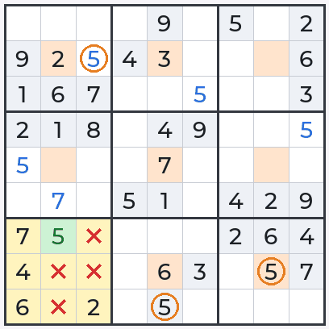

<!-- Written by tools/walkthrough.py center-dot: edit the script, not this page. -->
# Center Dot, step 6: the 5 in box 7

**Step 6 of 46** · [← Step 5](step-05.md) · [All steps](../center-dot.md#the-whole-puzzle-step-by-step) · [Step 7 →](step-07.md)

Box 7 needs a 5. r7c3: column 3 has one (r2c3). r8c2 and r8c3: row 8 has one (r8c8). r9c2: row 9 has one (r9c5). Only **r7c2** is left: **r7c2 = 5**.

**Step 6 of 46** · [← Step 5](step-05.md) · [All steps](../center-dot.md#the-whole-puzzle-step-by-step) · [Step 7 →](step-07.md)
