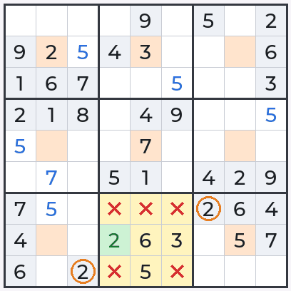

<!-- Written by tools/walkthrough.py center-dot: edit the script, not this page. -->
# Center Dot, step 7: the 2 in box 8

**Step 7 of 46** · [← Step 6](step-06.md) · [All steps](../center-dot.md#the-whole-puzzle-step-by-step) · [Step 8 →](step-08.md)

Box 8 needs a 2. r7c4, r7c5 and r7c6: row 7 has one (r7c7). r9c4 and r9c6: row 9 has one (r9c3). Only **r8c4** is left: **r8c4 = 2**.

**Step 7 of 46** · [← Step 6](step-06.md) · [All steps](../center-dot.md#the-whole-puzzle-step-by-step) · [Step 8 →](step-08.md)
