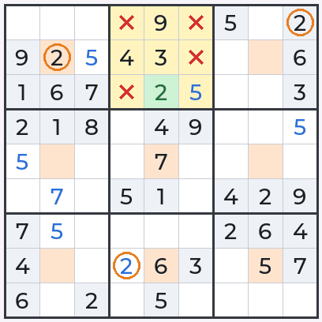

<!-- Written by tools/walkthrough.py center-dot: edit the script, not this page. -->
# Center Dot, step 8: the 2 in box 2

**Step 8 of 46** · [← Step 7](step-07.md) · [All steps](../center-dot.md#the-whole-puzzle-step-by-step) · [Step 9 →](step-09.md)

Box 2 needs a 2. r1c4 and r1c6: row 1 has one (r1c9). r2c6: row 2 has one (r2c2). r3c4: column 4 has one (r8c4). Only **r3c5** is left: **r3c5 = 2**.

**Step 8 of 46** · [← Step 7](step-07.md) · [All steps](../center-dot.md#the-whole-puzzle-step-by-step) · [Step 9 →](step-09.md)
