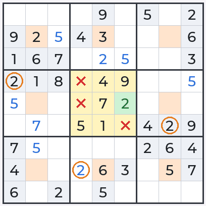

<!-- Written by tools/walkthrough.py center-dot: edit the script, not this page. -->
# Center Dot, step 9: the 2 in box 5

**Step 9 of 46** · [← Step 8](step-08.md) · [All steps](../center-dot.md#the-whole-puzzle-step-by-step) · [Step 10 →](step-10.md)

Box 5 needs a 2. r4c4: row 4 has one (r4c1). r5c4: column 4 has one (r8c4). r6c6: row 6 has one (r6c8). Only **r5c6** is left: **r5c6 = 2**.

**Step 9 of 46** · [← Step 8](step-08.md) · [All steps](../center-dot.md#the-whole-puzzle-step-by-step) · [Step 10 →](step-10.md)
