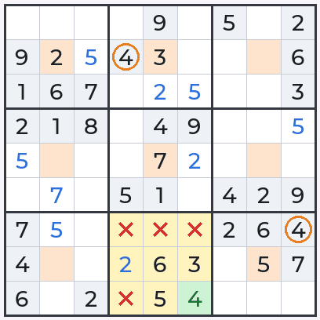

<!-- Written by tools/walkthrough.py center-dot: edit the script, not this page. -->
# Center Dot, step 10: the 4 in box 8

**Step 10 of 46** · [← Step 9](step-09.md) · [All steps](../center-dot.md#the-whole-puzzle-step-by-step) · [Step 11 →](step-11.md)

Box 8 needs a 4. r7c4, r7c5 and r7c6: row 7 has one (r7c9). r9c4: column 4 has one (r2c4). Only **r9c6** is left: **r9c6 = 4**.

**Step 10 of 46** · [← Step 9](step-09.md) · [All steps](../center-dot.md#the-whole-puzzle-step-by-step) · [Step 11 →](step-11.md)
