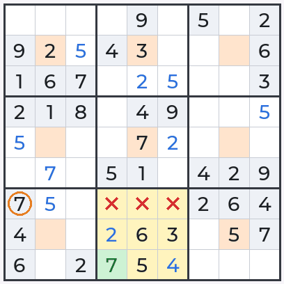

<!-- Written by tools/walkthrough.py center-dot: edit the script, not this page. -->
# Center Dot, step 11: the 7 in box 8

**Step 11 of 46** · [← Step 10](step-10.md) · [All steps](../center-dot.md#the-whole-puzzle-step-by-step) · [Step 12 →](step-12.md)

Box 8 needs a 7. r7c4, r7c5 and r7c6: row 7 has one (r7c1). Only **r9c4** is left: **r9c4 = 7**.

**Step 11 of 46** · [← Step 10](step-10.md) · [All steps](../center-dot.md#the-whole-puzzle-step-by-step) · [Step 12 →](step-12.md)
