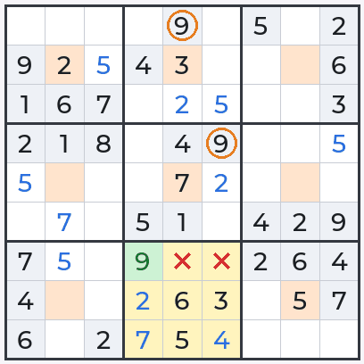

<!-- Written by tools/walkthrough.py center-dot: edit the script, not this page. -->
# Center Dot, step 12: the 9 in box 8

**Step 12 of 46** · [← Step 11](step-11.md) · [All steps](../center-dot.md#the-whole-puzzle-step-by-step) · [Step 13 →](step-13.md)

Box 8 needs a 9. r7c5: column 5 has one (r1c5). r7c6: column 6 has one (r4c6). Only **r7c4** is left: **r7c4 = 9**.

**Step 12 of 46** · [← Step 11](step-11.md) · [All steps](../center-dot.md#the-whole-puzzle-step-by-step) · [Step 13 →](step-13.md)
