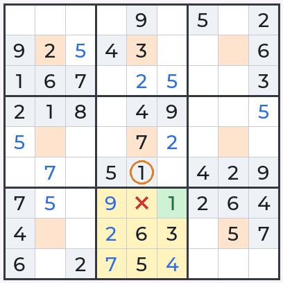

<!-- Written by tools/walkthrough.py center-dot: edit the script, not this page. -->
# Center Dot, step 13: the 1 in box 8

**Step 13 of 46** · [← Step 12](step-12.md) · [All steps](../center-dot.md#the-whole-puzzle-step-by-step) · [Step 14 →](step-14.md)

Box 8 needs a 1. r7c5: column 5 has one (r6c5). Only **r7c6** is left: **r7c6 = 1**.

**Step 13 of 46** · [← Step 12](step-12.md) · [All steps](../center-dot.md#the-whole-puzzle-step-by-step) · [Step 14 →](step-14.md)
