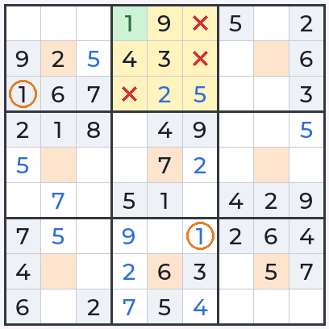

<!-- Written by tools/walkthrough.py center-dot: edit the script, not this page. -->
# Center Dot, step 14: the 1 in box 2

**Step 14 of 46** · [← Step 13](step-13.md) · [All steps](../center-dot.md#the-whole-puzzle-step-by-step) · [Step 15 →](step-15.md)

Box 2 needs a 1. r1c6 and r2c6: column 6 has one (r7c6). r3c4: row 3 has one (r3c1). Only **r1c4** is left: **r1c4 = 1**.

**Step 14 of 46** · [← Step 13](step-13.md) · [All steps](../center-dot.md#the-whole-puzzle-step-by-step) · [Step 15 →](step-15.md)
