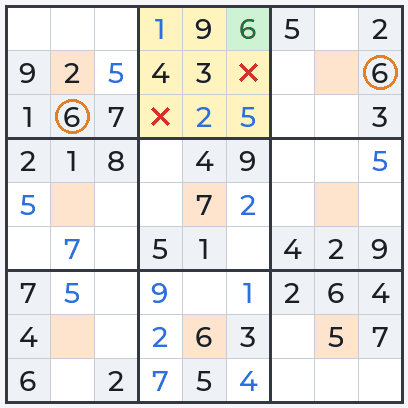

<!-- Written by tools/walkthrough.py center-dot: edit the script, not this page. -->
# Center Dot, step 15: the 6 in box 2

**Step 15 of 46** · [← Step 14](step-14.md) · [All steps](../center-dot.md#the-whole-puzzle-step-by-step) · [Step 16 →](step-16.md)

Box 2 needs a 6. r2c6: row 2 has one (r2c9). r3c4: row 3 has one (r3c2). Only **r1c6** is left: **r1c6 = 6**.

**Step 15 of 46** · [← Step 14](step-14.md) · [All steps](../center-dot.md#the-whole-puzzle-step-by-step) · [Step 16 →](step-16.md)
