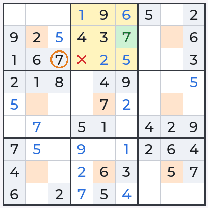

<!-- Written by tools/walkthrough.py center-dot: edit the script, not this page. -->
# Center Dot, step 16: the 7 in box 2

**Step 16 of 46** · [← Step 15](step-15.md) · [All steps](../center-dot.md#the-whole-puzzle-step-by-step) · [Step 17 →](step-17.md)

Box 2 needs a 7. r3c4: row 3 has one (r3c3). Only **r2c6** is left: **r2c6 = 7**.

**Step 16 of 46** · [← Step 15](step-15.md) · [All steps](../center-dot.md#the-whole-puzzle-step-by-step) · [Step 17 →](step-17.md)
