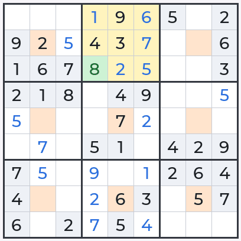

<!-- Written by tools/walkthrough.py center-dot: edit the script, not this page. -->
# Center Dot, step 17: the 8 in box 2

**Step 17 of 46** · [← Step 16](step-16.md) · [All steps](../center-dot.md#the-whole-puzzle-step-by-step) · [Step 18 →](step-18.md)

Box 2 needs an 8, and r3c4 is its last empty cell: **r3c4 = 8**.

**Step 17 of 46** · [← Step 16](step-16.md) · [All steps](../center-dot.md#the-whole-puzzle-step-by-step) · [Step 18 →](step-18.md)
