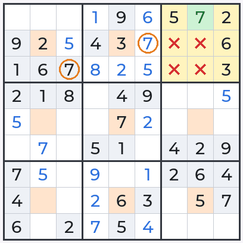

<!-- Written by tools/walkthrough.py center-dot: edit the script, not this page. -->
# Center Dot, step 18: the 7 in box 3

**Step 18 of 46** · [← Step 17](step-17.md) · [All steps](../center-dot.md#the-whole-puzzle-step-by-step) · [Step 19 →](step-19.md)

Box 3 needs a 7. r2c7 and r2c8: row 2 has one (r2c6). r3c7 and r3c8: row 3 has one (r3c3). Only **r1c8** is left: **r1c8 = 7**.

**Step 18 of 46** · [← Step 17](step-17.md) · [All steps](../center-dot.md#the-whole-puzzle-step-by-step) · [Step 19 →](step-19.md)
