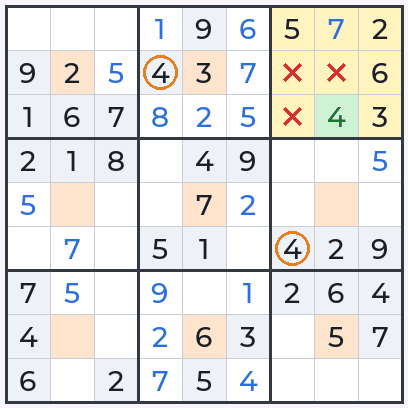

<!-- Written by tools/walkthrough.py center-dot: edit the script, not this page. -->
# Center Dot, step 19: the 4 in box 3

**Step 19 of 46** · [← Step 18](step-18.md) · [All steps](../center-dot.md#the-whole-puzzle-step-by-step) · [Step 20 →](step-20.md)

Box 3 needs a 4. r2c7 and r2c8: row 2 has one (r2c4). r3c7: column 7 has one (r6c7). Only **r3c8** is left: **r3c8 = 4**.

**Step 19 of 46** · [← Step 18](step-18.md) · [All steps](../center-dot.md#the-whole-puzzle-step-by-step) · [Step 20 →](step-20.md)
