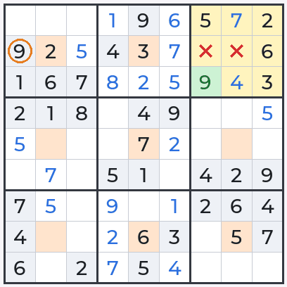

<!-- Written by tools/walkthrough.py center-dot: edit the script, not this page. -->
# Center Dot, step 20: the 9 in box 3

**Step 20 of 46** · [← Step 19](step-19.md) · [All steps](../center-dot.md#the-whole-puzzle-step-by-step) · [Step 21 →](step-21.md)

Box 3 needs a 9. r2c7 and r2c8: row 2 has one (r2c1). Only **r3c7** is left: **r3c7 = 9**.

**Step 20 of 46** · [← Step 19](step-19.md) · [All steps](../center-dot.md#the-whole-puzzle-step-by-step) · [Step 21 →](step-21.md)
