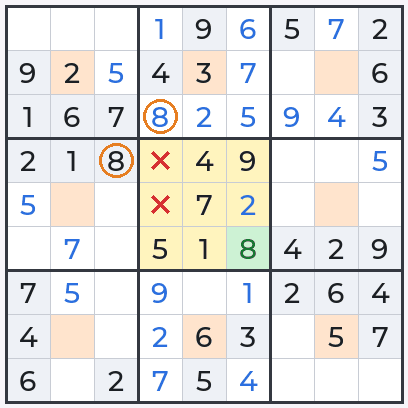

<!-- Written by tools/walkthrough.py center-dot: edit the script, not this page. -->
# Center Dot, step 21: the 8 in box 5

**Step 21 of 46** · [← Step 20](step-20.md) · [All steps](../center-dot.md#the-whole-puzzle-step-by-step) · [Step 22 →](step-22.md)

Box 5 needs an 8. r4c4: row 4 has one (r4c3). r5c4: column 4 has one (r3c4). Only **r6c6** is left: **r6c6 = 8**.

**Step 21 of 46** · [← Step 20](step-20.md) · [All steps](../center-dot.md#the-whole-puzzle-step-by-step) · [Step 22 →](step-22.md)
