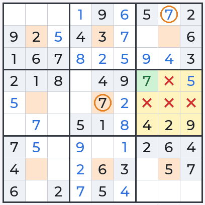

<!-- Written by tools/walkthrough.py center-dot: edit the script, not this page. -->
# Center Dot, step 22: the 7 in box 6

**Step 22 of 46** · [← Step 21](step-21.md) · [All steps](../center-dot.md#the-whole-puzzle-step-by-step) · [Step 23 →](step-23.md)

Box 6 needs a 7. r4c8: column 8 has one (r1c8). r5c7, r5c8 and r5c9: row 5 has one (r5c5). Only **r4c7** is left: **r4c7 = 7**.

**Step 22 of 46** · [← Step 21](step-21.md) · [All steps](../center-dot.md#the-whole-puzzle-step-by-step) · [Step 23 →](step-23.md)
