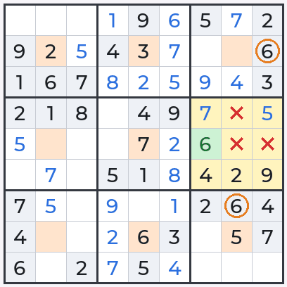

<!-- Written by tools/walkthrough.py center-dot: edit the script, not this page. -->
# Center Dot, step 23: the 6 in box 6

**Step 23 of 46** · [← Step 22](step-22.md) · [All steps](../center-dot.md#the-whole-puzzle-step-by-step) · [Step 24 →](step-24.md)

Box 6 needs a 6. r4c8 and r5c8: column 8 has one (r7c8). r5c9: column 9 has one (r2c9). Only **r5c7** is left: **r5c7 = 6**.

**Step 23 of 46** · [← Step 22](step-22.md) · [All steps](../center-dot.md#the-whole-puzzle-step-by-step) · [Step 24 →](step-24.md)
