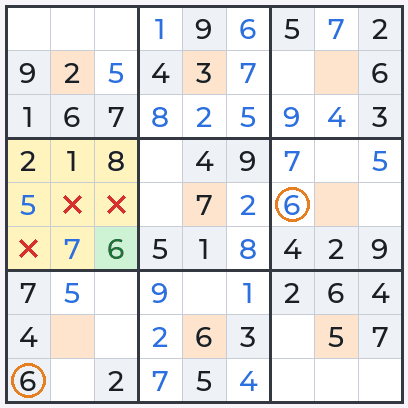

<!-- Written by tools/walkthrough.py center-dot: edit the script, not this page. -->
# Center Dot, step 24: the 6 in box 4

**Step 24 of 46** · [← Step 23](step-23.md) · [All steps](../center-dot.md#the-whole-puzzle-step-by-step) · [Step 25 →](step-25.md)

Box 4 needs a 6. r5c2 and r5c3: row 5 has one (r5c7). r6c1: column 1 has one (r9c1). Only **r6c3** is left: **r6c3 = 6**.

**Step 24 of 46** · [← Step 23](step-23.md) · [All steps](../center-dot.md#the-whole-puzzle-step-by-step) · [Step 25 →](step-25.md)
