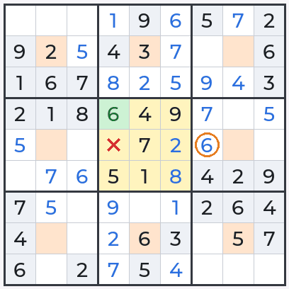

<!-- Written by tools/walkthrough.py center-dot: edit the script, not this page. -->
# Center Dot, step 25: the 6 in box 5

**Step 25 of 46** · [← Step 24](step-24.md) · [All steps](../center-dot.md#the-whole-puzzle-step-by-step) · [Step 26 →](step-26.md)

Box 5 needs a 6. r5c4: row 5 has one (r5c7). Only **r4c4** is left: **r4c4 = 6**.

**Step 25 of 46** · [← Step 24](step-24.md) · [All steps](../center-dot.md#the-whole-puzzle-step-by-step) · [Step 26 →](step-26.md)
