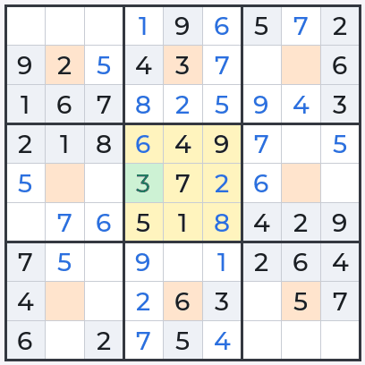

<!-- Written by tools/walkthrough.py center-dot: edit the script, not this page. -->
# Center Dot, step 26: the 3 in box 5

**Step 26 of 46** · [← Step 25](step-25.md) · [All steps](../center-dot.md#the-whole-puzzle-step-by-step) · [Step 27 →](step-27.md)

Box 5 needs a 3, and r5c4 is its last empty cell: **r5c4 = 3**.

**Step 26 of 46** · [← Step 25](step-25.md) · [All steps](../center-dot.md#the-whole-puzzle-step-by-step) · [Step 27 →](step-27.md)
