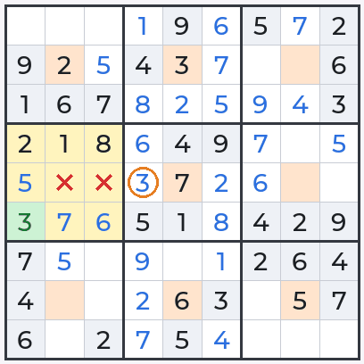

<!-- Written by tools/walkthrough.py center-dot: edit the script, not this page. -->
# Center Dot, step 27: the 3 in box 4

**Step 27 of 46** · [← Step 26](step-26.md) · [All steps](../center-dot.md#the-whole-puzzle-step-by-step) · [Step 28 →](step-28.md)

Box 4 needs a 3. r5c2 and r5c3: row 5 has one (r5c4). Only **r6c1** is left: **r6c1 = 3**.

**Step 27 of 46** · [← Step 26](step-26.md) · [All steps](../center-dot.md#the-whole-puzzle-step-by-step) · [Step 28 →](step-28.md)
