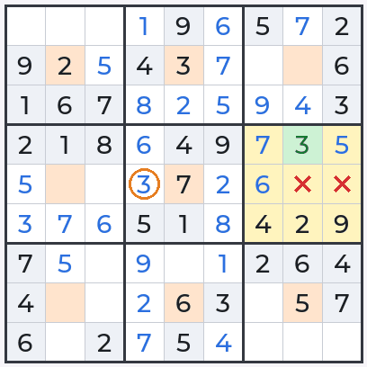

<!-- Written by tools/walkthrough.py center-dot: edit the script, not this page. -->
# Center Dot, step 28: the 3 in box 6

**Step 28 of 46** · [← Step 27](step-27.md) · [All steps](../center-dot.md#the-whole-puzzle-step-by-step) · [Step 29 →](step-29.md)

Box 6 needs a 3. r5c8 and r5c9: row 5 has one (r5c4). Only **r4c8** is left: **r4c8 = 3**.

**Step 28 of 46** · [← Step 27](step-27.md) · [All steps](../center-dot.md#the-whole-puzzle-step-by-step) · [Step 29 →](step-29.md)
