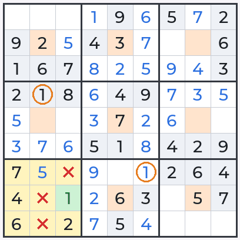

<!-- Written by tools/walkthrough.py center-dot: edit the script, not this page. -->
# Center Dot, step 29: the 1 in box 7

**Step 29 of 46** · [← Step 28](step-28.md) · [All steps](../center-dot.md#the-whole-puzzle-step-by-step) · [Step 30 →](step-30.md)

Box 7 needs a 1. r7c3: row 7 has one (r7c6). r8c2 and r9c2: column 2 has one (r4c2). Only **r8c3** is left: **r8c3 = 1**.

**Step 29 of 46** · [← Step 28](step-28.md) · [All steps](../center-dot.md#the-whole-puzzle-step-by-step) · [Step 30 →](step-30.md)
